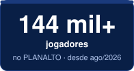
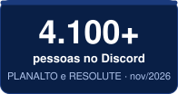
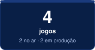
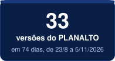

  

<h3 align="center">Fundador da KORU</h3>

  Estúdio de jogos brasileiro-neozelandês, fundado em 2026. 
  Dois jogos no ar, dois em produção.

  
  
  

## Em números

  
  
  
  

## Jogos

<table>
  <tr>
    <td width="50%" valign="top">
      
        
      
      <h3>PLANALTO</h3>
      Simulador da Presidência do Brasil. Você escreve a medida com as suas palavras e 513 deputados votam um a um.
        
      Navegador · no ar desde 23 de agosto de 2026
       
      <a href="https://planalto.fun"><b>Jogar</b></a> ·
      <a href="https://koruinteractive.com/planalto/">Sobre o jogo</a> ·
      <a href="https://planalto.fun/discord">Discord</a>
    </td>
    <td width="50%" valign="top">
      
        
      
      <h3>RESOLUTE</h3>
      Simulador da Presidência dos Estados Unidos. Você escreve o que faz; o Congresso negocia bancada por bancada e o país responde.
        
      Navegador · em inglês e português · no ar desde 9 de outubro de 2026
       
      <a href="https://resolutethegame.com"><b>Jogar</b></a> ·
      <a href="https://koruinteractive.com/resolute/">Sobre o jogo</a> ·
      <a href="https://resolutethegame.com/discord">Discord</a>
    </td>
  </tr>
  <tr>
    <td width="50%" valign="top">
      
        
      
      <h3>OCTÓGONO</h3>
      Carreira de MMA. Do primeiro contrato à aposentadoria: 22 lutas para virar alguém.
        
      Navegador · em desenvolvimento, sem data
       
      <a href="https://koruinteractive.com/octogono/"><b>Ver o que já dá para mostrar</b></a>
    </td>
    <td width="50%" valign="top">
      
        
      
      <h3>Pega no Tranco</h3>
      Sobrevivência e carro em primeira pessoa no interior de Minas Gerais em 1996, sozinho ou com até três primos.
        
      PC, na Steam · em breve, em acesso antecipado
       
      <a href="https://www.youtube.com/watch?v=HvUfyR13jH8"><b>Trailer</b></a> ·
      <a href="https://koruinteractive.com/peganotranco/">Sobre o jogo</a> ·
      <a href="https://www.instagram.com/peganotranco/">Instagram</a> ·
      <a href="https://x.com/peganotranco_">X</a>
    </td>
  </tr>
</table>

<b>English</b>

 

Founder of **KORU**, a Brazilian–New Zealand game studio founded in 2026. It made PLANALTO, a simulator of the Brazilian presidency, and RESOLUTE, a simulator of the American one: browser games in which players write their own measures and the country reacts. More than 144,000 people have played PLANALTO. In development are OCTÓGONO, an MMA career game, and Pega no Tranco, a survival game set in rural Minas Gerais in 1996.

More at [koruinteractive.com/en](https://koruinteractive.com/en/).

---

  <i>koru</i>, em māori: o broto da samambaia ainda enrolado, antes de abrir. 
  凝る (<i>koru</i>), em japonês: caprichar, fazer com esmero, detalhe por detalhe.
    
  Contato e imprensa: <a href="https://koruinteractive.com/contato/">koruinteractive.com/contato</a>

