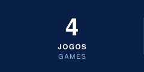
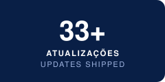
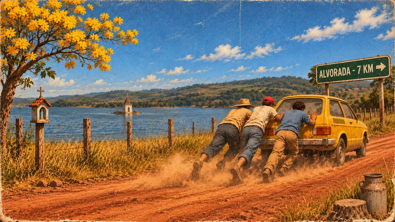

  

<h3 align="center">Fundador da KORU</h3>

  Estúdio de jogos brasileiro-neozelandês, fundado em 2026. 
  Dois jogos no ar, dois em produção.

  <i>Founder of KORU. A Brazilian–New Zealand game studio, founded in 2026. 
  Two games live, two in production.</i>

  
  
  

  

## Jogos · Games

<table>
  <tr>
    <td width="40%" valign="top">
      
    </td>
    <td valign="top">
      
      <h3>PLANALTO</h3>
      <b>Simulador da Presidência do Brasil</b> 
      <i>A simulator of the Brazilian presidency</i>
        
      Navegador · no ar desde 23 de agosto de 2026 · primeiro ano grátis 
      Browser · live since 23 August 2026 · first year free
        
      <a href="https://planalto.fun"><b>Jogar · Play</b></a> ·
      <a href="https://koruinteractive.com/planalto/">Sobre</a> /
      <a href="https://koruinteractive.com/en/planalto/">About</a> ·
      <a href="https://planalto.fun/discord">Discord</a>
    </td>
  </tr>
  <tr>
    <td colspan="2">
      Não existe lista de decisões: você escreve a medida com as suas palavras e o jogo escolhe o instrumento que a Constituição pede, de decreto a PEC. 513 deputados, cada um com nome, partido, região e opinião sobre você, votam um a um. A aprovação muda em 32 grupos sociais e nos 27 estados, a inflação, o câmbio e a dívida se mexem e, no dia seguinte, três jornais dão a manchete.
        
      <b>Dentro do jogo:</b> Senado voto a voto · coalizão, Centrão e CPIs · STF · uma crise por mês · campanha de 2026 contra os candidatos reais · até cinco mandatos, de 2027 a 2046 · perdeu a eleição? Dá para tentar ficar, e aí o jogo vira ditadura.
        
      <i>There is no list of choices: you write each measure in your own words and the game picks the instrument the Constitution requires, from a decree to a constitutional amendment. 513 deputies, each with a name, a party, a region and an opinion of you, vote one by one. Approval moves in 32 social groups and the 27 states, inflation, the exchange rate and the debt move too and, the next day, three newspapers run the headline.</i>
        
      <i><b>Inside the game:</b> the Senate, vote by vote · coalition, the Centrão and inquiries · the Supreme Court · one crisis a month · the 2026 campaign against the real candidates · up to five terms, from 2027 to 2046 · lost the election? You can try to stay, and the game turns into a dictatorship.</i>
    </td>
  </tr>
</table>

<table>
  <tr>
    <td width="40%" valign="top">
      
    </td>
    <td valign="top">
      
      <h3>RESOLUTE</h3>
      <b>Simulador da Presidência dos Estados Unidos</b> 
      <i>A simulator of the American presidency</i>
        
      Navegador · em inglês e português · no ar desde 9 de outubro de 2026 
      Browser · in English and Portuguese · live since 9 October 2026
        
      <a href="https://resolutethegame.com"><b>Jogar · Play</b></a> ·
      <a href="https://koruinteractive.com/resolute/">Sobre</a> /
      <a href="https://koruinteractive.com/en/resolute/">About</a> ·
      <a href="https://resolutethegame.com/discord">Discord</a>
    </td>
  </tr>
  <tr>
    <td colspan="2">
      Salão Oval, 20 de janeiro de 2029. Não há menu de respostas prontas: você escreve o que faz, em inglês ou em português, e 535 congressistas reais, nove juízes da Suprema Corte, cinquenta governadores e um país de dezoito grupos reagem. Na Câmara são 218 votos; no Senado, 60 para vencer o filibuster. Treze bancadas negociam, e um acordo rompido custa a próxima votação.
        
      <b>Dentro do jogo:</b> gabinete de secretários que entregam, se desgastam e saem para concorrer · economia com o Fed, a gasolina, a bolsa e o teto da dívida · Suprema Corte com vagas, sabatinas e a ação que derruba a sua lei · quinze países e visitas de Estado no Air Force One · campanha de 2028 com três debates e a noite da eleição.
        
      <i>The Oval Office, January 20, 2029. There is no menu of canned choices: you write what you do, in English or in Portuguese, and 535 real members of Congress, nine justices, fifty governors and a country of eighteen groups react. 218 votes in the House; 60 in the Senate to beat the filibuster. Thirteen caucuses bargain, and a broken deal costs you the next roll call.</i>
        
      <i><b>Inside the game:</b> a Cabinet of secretaries who deliver, wear out and leave to run for office · an economy with the Fed, gas prices, the stock market and the debt ceiling · a Supreme Court with vacancies, hearings and the lawsuit that strikes your law down · fifteen countries and state visits on Air Force One · the 2028 campaign, with three debates and election night.</i>
    </td>
  </tr>
</table>

<table>
  <tr>
    <td width="40%" valign="top">
      
    </td>
    <td valign="top">
      
      <h3>OCTÓGONO</h3>
      <b>Carreira de MMA: 22 lutas para virar alguém.</b> 
      <i>MMA career: 22 fights to become somebody.</i>
        
      Navegador · em desenvolvimento, sem data 
      Browser · in development, no date yet
        
      <a href="https://koruinteractive.com/octogono/"><b>Sobre</b></a> /
      <a href="https://koruinteractive.com/en/octogono/"><b>About</b></a>
    </td>
  </tr>
  <tr>
    <td colspan="2">
      Você assina o primeiro contrato sem apelido e com o cartel zerado. Até a aposentadoria são 22 lutas, e o que acontece entre uma e outra pesa tanto quanto o que acontece dentro: patrocínio duvidoso, corte de peso dando errado, treinador querendo sair.
        
      <b>Dentro do jogo:</b> ranking, temporadas e cinturão em disputa · divisões masculinas e femininas, do peso-palha ao peso-pesado · online às cegas: os dois escolhem o golpe ao mesmo tempo, sem ver o do outro.
        
      <i>You sign your first contract with no nickname and a clean record. Retirement is 22 fights away, and what happens between fights matters as much as what happens in them: shady sponsors, weight cuts gone wrong, a coach who wants out.</i>
        
      <i><b>Inside the game:</b> rankings, seasons and a belt on the line · men's and women's divisions, from strawweight to heavyweight · online, blind: both fighters pick the move at the same time, without seeing the other's.</i>
    </td>
  </tr>
</table>

<table>
  <tr>
    <td width="40%" valign="top">
      
    </td>
    <td valign="top">
      
      <h3>Pega no Tranco</h3>
      <b>O carro do vô, a rádio AM e o truco de quinta.</b> 
      <i>Grandpa's car, AM radio and Thursday card games.</i>
        
      PC, na Steam · 1 a 4 jogadores · em breve, em acesso antecipado 
      PC, on Steam · 1 to 4 players · coming soon, in early access
        
      <a href="https://www.youtube.com/watch?v=HvUfyR13jH8"><b>Trailer</b></a> ·
      <a href="https://koruinteractive.com/peganotranco/">Sobre</a> /
      <a href="https://koruinteractive.com/en/peganotranco/">About</a> ·
      <a href="https://www.instagram.com/peganotranco/">Instagram</a> ·
      <a href="https://x.com/peganotranco_">X</a>
    </td>
  </tr>
  <tr>
    <td colspan="2">
      Minas Gerais, inverno de 1996. Seu avô morreu, sua mãe pegou o ônibus para São Paulo e você ficou no sítio com cinquenta reais no bolso e o que o velho deixou no paiol: a Mula, uma caminhonete que não quebra mas bebe muito; a Candanga, o carrinho amarelo de motor a ar que ele desmontou peça por peça; e a caderneta, escrita à mão, com tudo o que ele sabia e algumas coisas que ele nunca contou.
        
      <b>Dentro do jogo:</b> montar o carro parafuso por parafuso, com gambiarra de arame, fita isolante e barbante quando falta a peça · fome, sede, sono, sujeira e a conta de luz · roça, café, botijão, pesca, truco valendo dinheiro e a linha do Paraguai · até quatro jogadores: o primo chega de ônibus e ajuda a empurrar até pegar no tranco · dois segredos que ninguém vai mandar você procurar.
        
      <i>Rural Minas Gerais, winter of 1996. Your grandfather died, your mother took the bus to São Paulo and you stayed at the farm with fifty reais in your pocket and what the old man left in the barn: the Mule, a pickup that never breaks but drinks a lot; the Candanga, the little yellow air-cooled car he took apart piece by piece; and the notebook, handwritten, with everything he knew and a few things he never told.</i>
        
      <i><b>Inside the game:</b> rebuild the car bolt by bolt, with a makeshift fix of wire, electrical tape and string when the part doesn't exist · hunger, thirst, sleep, dirt and the electricity bill · field work, coffee picking, gas deliveries, fishing, truco for money and the Paraguay run · up to four players: a cousin gets off the bus and helps push until it starts · two secrets nobody will send you looking for.</i>
    </td>
  </tr>
</table>

---

  <i>koru</i>, em māori: o broto da samambaia ainda enrolado, antes de abrir. 
  凝る (<i>koru</i>), em japonês: caprichar, fazer com esmero, detalhe por detalhe.
    
  <i>koru</i>, in Māori: the fern frond, still curled, before it opens. 
  凝る (<i>koru</i>), in Japanese: to take great care, to work at something detail by detail.
    
  Contato e imprensa · Contact and press: <a href="https://koruinteractive.com/contato/">koruinteractive.com/contato</a>

