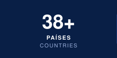
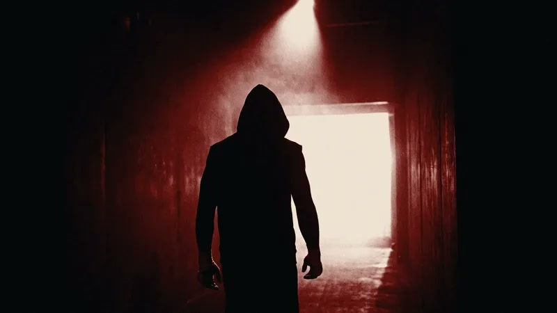

  

<h3 align="center">Fundador da KORU</h3>

  Estúdio de jogos brasileiro-neozelandês, fundado em 2026. 
  Dois jogos no ar, dois em produção.

  <i>Founder of KORU. A Brazilian–New Zealand game studio, founded in 2026. 
  Two games live, two in production.</i>

  
  
  

  

## Jogos · Games

<table>
  <tr>
    <td width="40%" valign="top">
      
    </td>
    <td valign="top">
      
      <h3>PLANALTO</h3>
      <b>Simulador da Presidência do Brasil.</b> Não existe lista de decisões: você escreve a medida com as suas palavras. 513 deputados votam um a um, 27 governadores cobram, a economia reage e a imprensa repercute.
       
      <i><b>A simulator of the Brazilian presidency.</b> There is no list of choices: you write each measure in your own words. 513 deputies vote one by one, 27 governors push back, the economy reacts and the press covers it.</i>
        
      <a href="https://planalto.fun"><b>Jogar · Play</b></a> ·
      <a href="https://koruinteractive.com/planalto/">Sobre</a> /
      <a href="https://koruinteractive.com/en/planalto/">About</a> ·
      <a href="https://planalto.fun/discord">Discord</a>
    </td>
  </tr>
</table>

<table>
  <tr>
    <td width="40%" valign="top">
      
    </td>
    <td valign="top">
      
      <h3>RESOLUTE</h3>
      <b>Simulador da Presidência dos Estados Unidos.</b> Você escreve o que faz, em inglês ou em português, e 535 congressistas, nove juízes da Suprema Corte, cinquenta governadores e um país de dezoito grupos reagem.
       
      <i><b>A simulator of the American presidency.</b> You write what you do, in English or in Portuguese, and 535 members of Congress, nine justices, fifty governors and a country of eighteen groups react.</i>
        
      <a href="https://resolutethegame.com"><b>Jogar · Play</b></a> ·
      <a href="https://koruinteractive.com/resolute/">Sobre</a> /
      <a href="https://koruinteractive.com/en/resolute/">About</a> ·
      <a href="https://resolutethegame.com/discord">Discord</a>
    </td>
  </tr>
</table>

<table>
  <tr>
    <td width="40%" valign="top">
      
    </td>
    <td valign="top">
      
      <h3>OCTÓGONO</h3>
      <b>Carreira de MMA.</b> Do primeiro contrato à aposentadoria são 22 lutas, e o que acontece entre uma e outra pesa tanto quanto o que acontece dentro. Online, os dois escolhem o golpe ao mesmo tempo, sem ver o do outro.
       
      <i><b>MMA career.</b> Retirement is 22 fights away, and what happens between fights matters as much as what happens in them. Online, both fighters pick the move at the same time, blind.</i>
        
      <a href="https://koruinteractive.com/octogono/"><b>Sobre</b></a> /
      <a href="https://koruinteractive.com/en/octogono/"><b>About</b></a>
    </td>
  </tr>
</table>

<table>
  <tr>
    <td width="40%" valign="top">
      
    </td>
    <td valign="top">
      
      <h3>Pega no Tranco</h3>
      <b>Sobrevivência e carro em primeira pessoa.</b> Minas Gerais, 1996. Monte o carro do seu avô parafuso por parafuso, viva da roça, do bar e do truco, e chame até três primos. Para PC, na Steam.
       
      <i><b>First-person survival and car building.</b> Rural Brazil, 1996. Rebuild your grandfather's car bolt by bolt, live off the land, the bar and card games, and call up to three cousins. For PC, on Steam.</i>
        
      <a href="https://www.youtube.com/watch?v=HvUfyR13jH8"><b>Trailer</b></a> ·
      <a href="https://koruinteractive.com/peganotranco/">Sobre</a> /
      <a href="https://koruinteractive.com/en/peganotranco/">About</a> ·
      <a href="https://www.instagram.com/peganotranco/">Instagram</a> ·
      <a href="https://x.com/peganotranco_">X</a>
    </td>
  </tr>
</table>

---

  <i>koru</i>, em māori: o broto da samambaia ainda enrolado, antes de abrir. 
  凝る (<i>koru</i>), em japonês: caprichar, fazer com esmero, detalhe por detalhe.
    
  <i>koru</i>, in Māori: the fern frond, still curled, before it opens. 
  凝る (<i>koru</i>), in Japanese: to take great care, to work at something detail by detail.
    
  Contato e imprensa · Contact and press: <a href="https://koruinteractive.com/contato/">koruinteractive.com/contato</a>

