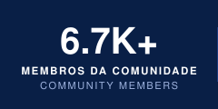

  

<h3 align="center">Fundador da KORU</h3>

  Estúdio de jogos brasileiro-neozelandês, fundado em 2026. 
  Dois jogos no ar, dois em produção.

  <i>Founder of KORU. A Brazilian–New Zealand game studio, founded in 2026. 
  Two games live, two in production.</i>

  
  
  

  

## Jogos · Games

<table>
  <tr>
    <td width="50%" valign="top">
      
        
      
      <h3>PLANALTO</h3>
      Simulador da Presidência do Brasil. Você escreve a medida com as suas palavras e 513 deputados votam um a um.
       
      <i>A simulator of the Brazilian presidency. You write each measure in your own words and 513 deputies vote one by one.</i>
        
      Navegador · no ar desde 23 de agosto de 2026 Browser · live since 23 August 2026
       
      <a href="https://planalto.fun"><b>Jogar · Play</b></a> ·
      <a href="https://koruinteractive.com/planalto/">Sobre</a> /
      <a href="https://koruinteractive.com/en/planalto/">About</a> ·
      <a href="https://planalto.fun/discord">Discord</a>
    </td>
    <td width="50%" valign="top">
      
        
      
      <h3>RESOLUTE</h3>
      Simulador da Presidência dos Estados Unidos. Você escreve o que faz; o Congresso negocia bancada por bancada e o país responde.
       
      <i>A simulator of the American presidency. You write what you do; Congress bargains caucus by caucus and the country answers.</i>
        
      Navegador · em inglês e português · no ar desde 9 de outubro de 2026 Browser · in English and Portuguese · live since 9 October 2026
       
      <a href="https://resolutethegame.com"><b>Jogar · Play</b></a> ·
      <a href="https://koruinteractive.com/resolute/">Sobre</a> /
      <a href="https://koruinteractive.com/en/resolute/">About</a> ·
      <a href="https://resolutethegame.com/discord">Discord</a>
    </td>
  </tr>
  <tr>
    <td width="50%" valign="top">
      
        
      
      <h3>OCTÓGONO</h3>
      Carreira de MMA. Do primeiro contrato à aposentadoria: 22 lutas para virar alguém.
       
      <i>MMA career. From the first contract to retirement: 22 fights to become somebody.</i>
        
      Navegador · em desenvolvimento, sem data Browser · in development, no date yet
       
      <a href="https://koruinteractive.com/octogono/"><b>Sobre</b></a> /
      <a href="https://koruinteractive.com/en/octogono/"><b>About</b></a>
    </td>
    <td width="50%" valign="top">
      
        
      
      <h3>Pega no Tranco</h3>
      Sobrevivência e carro em primeira pessoa no interior de Minas Gerais em 1996, sozinho ou com até três primos.
       
      <i>First-person survival and car fixing in rural Minas Gerais, Brazil, in 1996, solo or with up to three cousins.</i>
        
      PC, na Steam · em breve, em acesso antecipado PC, on Steam · coming soon, in early access
       
      <a href="https://www.youtube.com/watch?v=HvUfyR13jH8"><b>Trailer</b></a> ·
      <a href="https://koruinteractive.com/peganotranco/">Sobre</a> /
      <a href="https://koruinteractive.com/en/peganotranco/">About</a> ·
      <a href="https://www.instagram.com/peganotranco/">Instagram</a> ·
      <a href="https://x.com/peganotranco_">X</a>
    </td>
  </tr>
</table>

---

  <i>koru</i>, em māori: o broto da samambaia ainda enrolado, antes de abrir. 
  凝る (<i>koru</i>), em japonês: caprichar, fazer com esmero, detalhe por detalhe.
    
  <i>koru</i>, in Māori: the fern frond, still curled, before it opens. 
  凝る (<i>koru</i>), in Japanese: to take great care, to work at something detail by detail.
    
  Contato e imprensa · Contact and press: <a href="https://koruinteractive.com/contato/">koruinteractive.com/contato</a>

