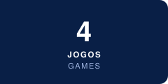

  

<h3 align="center">Fundador da KORU</h3>

  Estúdio de jogos brasileiro-neozelandês, fundado em 2026. 
  Dois jogos no ar, dois em produção.

  <i>Founder of KORU. A Brazilian–New Zealand game studio, founded in 2026. 
  Two games live, two in production.</i>

  
  
  

  

## Jogos · Games

<table>
  <tr>
    <td width="40%" valign="top">
      
    </td>
    <td valign="top">
      
      <h3>PLANALTO</h3>
      <b>Simulador da Presidência do Brasil.</b> Aqui se governa escrevendo, sem menu de opções. Vença a eleição de 2026 contra os candidatos reais, compre o Centrão com emenda e ministério, brigue com o Banco Central, sobreviva à CPI e ao impeachment. E, se a República cansar, traga a Coroa de volta.
       
      <i><b>A simulator of the Brazilian presidency.</b> You govern by writing, with no menu of options. Win the 2026 election against the real candidates, buy the Centrão with budget amendments and ministries, pick a fight with the Central Bank, survive inquiries and impeachment. And if the Republic wears thin, bring the Crown back.</i>
        
      <a href="https://planalto.fun"><b>Jogar · Play</b></a> ·
      <a href="https://koruinteractive.com/planalto/">Sobre</a> /
      <a href="https://koruinteractive.com/en/planalto/">About</a> ·
      <a href="https://planalto.fun/discord">Discord</a>
    </td>
  </tr>
</table>

<table>
  <tr>
    <td width="40%" valign="top">
      
    </td>
    <td valign="top">
      
      <h3>RESOLUTE</h3>
      <b>Simulador da Presidência dos Estados Unidos.</b> Tome posse em janeiro de 2029 e descubra que nada passa de graça: negocie com as bancadas, enfrente o filibuster, indique juízes para a Suprema Corte, pressione o Fed e escape do shutdown. Entre uma crise e outra, o Air Force One, três debates e a noite da eleição. Em inglês e em português.
       
      <i><b>A simulator of the American presidency.</b> Take the oath in January 2029 and find out that nothing passes for free: bargain with the caucuses, face the filibuster, put justices on the Supreme Court, lean on the Fed and dodge a shutdown. Between crises, Air Force One, three debates and election night. In English and Portuguese.</i>
        
      <a href="https://resolutethegame.com"><b>Jogar · Play</b></a> ·
      <a href="https://koruinteractive.com/resolute/">Sobre</a> /
      <a href="https://koruinteractive.com/en/resolute/">About</a> ·
      <a href="https://resolutethegame.com/discord">Discord</a>
    </td>
  </tr>
</table>

<table>
  <tr>
    <td width="40%" valign="top">
      
    </td>
    <td valign="top">
      
      <h3>OCTÓGONO</h3>
      <b>Carreira de MMA.</b> Você assina o primeiro contrato sem apelido e com o cartel zerado. São 22 lutas até a aposentadoria, e fora do octógono a coisa também aperta: patrocínio duvidoso, corte de peso dando errado, treinador querendo sair. No online, os dois escolhem o golpe ao mesmo tempo, sem ver o do outro.
       
      <i><b>MMA career.</b> You sign your first contract with no nickname and a clean record. Retirement is 22 fights away, and outside the cage it gets rough too: shady sponsors, weight cuts gone wrong, a coach who wants out. Online, both fighters pick their move at the same time, blind.</i>
        
      <a href="https://koruinteractive.com/octogono/"><b>Sobre</b></a> /
      <a href="https://koruinteractive.com/en/octogono/"><b>About</b></a>
    </td>
  </tr>
</table>

<table>
  <tr>
    <td width="40%" valign="top">
      
    </td>
    <td valign="top">
      
      <h3>Pega no Tranco</h3>
      <b>Sobrevivência e carro em primeira pessoa.</b> Minas Gerais, 1996. Seu avô deixou no paiol um carro amarelo em peças e uma caderneta escrita à mão. Monte parafuso por parafuso, resolva na gambiarra, colha café, jogue truco valendo dinheiro e chame os primos para empurrar até pegar no tranco.
       
      <i><b>First-person survival and car building.</b> Rural Brazil, 1996. Your grandfather left a yellow car in pieces in the barn and a handwritten notebook. Rebuild it bolt by bolt, patch it up with wire and tape, pick coffee, play truco for money and call your cousins to push until it starts.</i>
        
      <a href="https://www.youtube.com/watch?v=HvUfyR13jH8"><b>Trailer</b></a> ·
      <a href="https://koruinteractive.com/peganotranco/">Sobre</a> /
      <a href="https://koruinteractive.com/en/peganotranco/">About</a> ·
      <a href="https://www.instagram.com/peganotranco/">Instagram</a> ·
      <a href="https://x.com/peganotranco_">X</a>
    </td>
  </tr>
</table>

---

  <i>koru</i>, em māori: o broto da samambaia ainda enrolado, antes de abrir. 
  凝る (<i>koru</i>), em japonês: caprichar, fazer com esmero, detalhe por detalhe.
    
  <i>koru</i>, in Māori: the fern frond, still curled, before it opens. 
  凝る (<i>koru</i>), in Japanese: to take great care, to work at something detail by detail.
    
  Contato e imprensa · Contact and press: <a href="https://koruinteractive.com/contato/">koruinteractive.com/contato</a>

