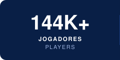

  

<h3 align="center">Fundador da KORU</h3>

  Estúdio de jogos brasileiro-neozelandês, fundado em 2026. 
  Dois jogos no ar, dois em produção.

  <i>Founder of KORU. A Brazilian–New Zealand game studio, founded in 2026. 
  Two games live, two in production.</i>

  
  
  

  

## Jogos · Games

<table>
  <tr>
    <td width="40%" valign="top">
      
    </td>
    <td valign="top">
      
      <h3>PLANALTO</h3>
      <b>Simulador da Presidência do Brasil.</b> Você escreve a medida com as suas palavras. A IA só interpreta o texto; um motor determinístico decide o resto: o instrumento que a Constituição exige, do decreto à PEC, e o voto de cada um dos 594 parlamentares. O placar previsto é a própria votação, rodada antes com a mesma semente.
       
      <i><b>A simulator of the Brazilian presidency.</b> You write each measure in your own words. The AI only interprets the text; a deterministic engine decides the rest: the instrument the Constitution requires, from a decree to a constitutional amendment, and the vote of each of the 594 legislators. The projected tally is the vote itself, run ahead with the same seed.</i>
        
      <code>TypeScript</code> <code>Next.js</code> <code>Cloudflare&nbsp;Workers</code> <code>160K-line&nbsp;engine</code> <code>3,500&nbsp;tests</code>
        
      <a href="https://planalto.fun"><b>Jogar · Play</b></a> ·
      <a href="https://koruinteractive.com/planalto/">Sobre</a> /
      <a href="https://koruinteractive.com/en/planalto/">About</a> ·
      <a href="https://planalto.fun/discord">Discord</a>
    </td>
  </tr>
</table>

<table>
  <tr>
    <td width="40%" valign="top">
      
    </td>
    <td valign="top">
      
      <h3>RESOLUTE</h3>
      <b>Simulador da Presidência dos Estados Unidos.</b> Os 535 congressistas têm nome real e partem da ideologia medida de cada um (DW-NOMINATE). Cada um vota pelo próprio modelo, e a chance que aparece no botão é a chance da votação. Bilíngue até o parser, com um Fed que segue a regra de Taylor e a noite da eleição apurada estado por estado.
       
      <i><b>A simulator of the American presidency.</b> All 535 members of Congress carry real names and start from their measured ideology (DW-NOMINATE). Each votes through their own model, and the odds on the button are the odds of the vote. Bilingual down to the parser, with a Taylor-rule Fed and an election night counted state by state.</i>
        
      <code>TypeScript</code> <code>Next.js</code> <code>Cloudflare&nbsp;Workers</code> <code>18&nbsp;modules</code> <code>138K&nbsp;lines</code> <code>574&nbsp;tests</code>
        
      <a href="https://resolutethegame.com"><b>Jogar · Play</b></a> ·
      <a href="https://koruinteractive.com/resolute/">Sobre</a> /
      <a href="https://koruinteractive.com/en/resolute/">About</a> ·
      <a href="https://resolutethegame.com/discord">Discord</a>
    </td>
  </tr>
</table>

<table>
  <tr>
    <td width="40%" valign="top">
      
    </td>
    <td valign="top">
      
      <h3>OCTÓGONO</h3>
      <b>Carreira de MMA em 22 lutas.</b> O que acontece entre uma luta e outra pesa tanto quanto o que acontece dentro. No online, os dois escolhem o golpe ao mesmo tempo, sem ver o do outro.
       
      <i><b>An MMA career in 22 fights.</b> What happens between fights matters as much as what happens in them. Online, both fighters pick their move at the same time, blind.</i>
        
      <a href="https://koruinteractive.com/octogono/"><b>Sobre</b></a> /
      <a href="https://koruinteractive.com/en/octogono/"><b>About</b></a>
    </td>
  </tr>
</table>

<table>
  <tr>
    <td width="40%" valign="top">
      
    </td>
    <td valign="top">
      
      <h3>Pega no Tranco</h3>
      <b>Sobrevivência e carro em primeira pessoa</b>, Minas Gerais, 1996. Um mundo aberto de 8 × 5,7 km gerado por código a partir do desenho do mapa: relevo, estradas, duas cidades e 470 mil árvores, com dia e noite pelo sol de julho a 21° Sul. Para até quatro jogadores.
       
      <i><b>First-person survival and car building</b>, rural Brazil, 1996. An 8 × 5.7 km open world generated by code from the map drawing: terrain, roads, two towns and 470,000 trees, with day and night driven by the July sun at 21° South. For up to four players.</i>
        
      <code>Unity&nbsp;6&nbsp;(URP)</code> <code>C#</code> <code>96K&nbsp;lines</code> <code>138K&nbsp;lines&nbsp;of&nbsp;Python&nbsp;tooling</code> <code>Steam</code>
        
      <a href="https://www.youtube.com/watch?v=HvUfyR13jH8"><b>Trailer</b></a> ·
      <a href="https://koruinteractive.com/peganotranco/">Sobre</a> /
      <a href="https://koruinteractive.com/en/peganotranco/">About</a> ·
      <a href="https://www.instagram.com/peganotranco/">Instagram</a> ·
      <a href="https://x.com/peganotranco_">X</a>
    </td>
  </tr>
</table>

---

  <i>koru</i>, em māori: o broto da samambaia ainda enrolado, antes de abrir. 
  凝る (<i>koru</i>), em japonês: caprichar, fazer com esmero, detalhe por detalhe.
    
  <i>koru</i>, in Māori: the fern frond, still curled, before it opens. 
  凝る (<i>koru</i>), in Japanese: to take great care, to work at something detail by detail.
    
  Contato e imprensa · Contact and press: <a href="https://koruinteractive.com/contato/">koruinteractive.com/contato</a>

